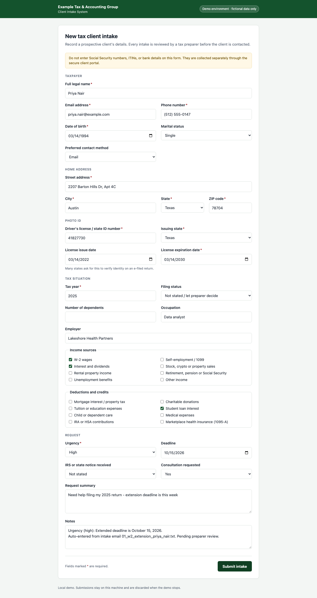
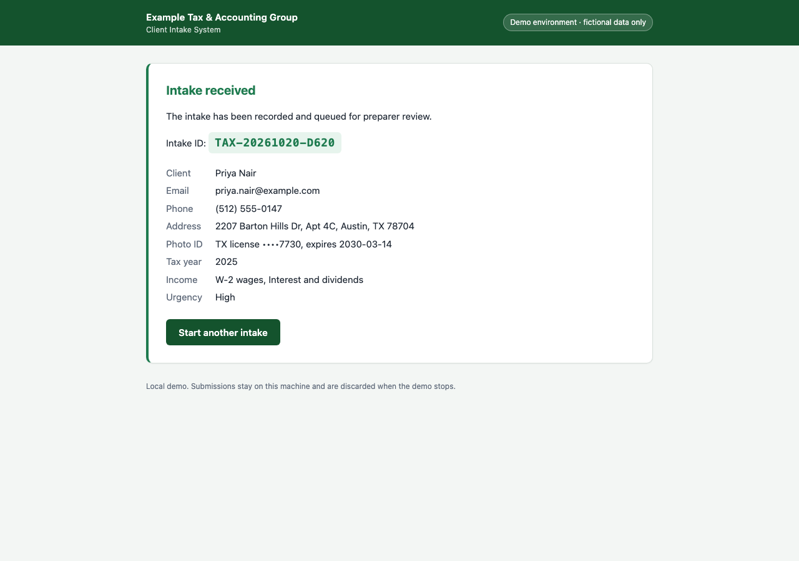

# Tax Client Intake Automation

Turns emails and intake PDFs from prospective tax clients into completed intake records, automatically.

It reads an inquiry (a text file or PDF), strips out any Social Security or bank numbers, uses AI to pull out the client's details, fills in the firm's intake form in a real browser, checks that the submission went through, and writes a summary report. Anything incomplete is held back for a human instead of being guessed.

> **This is a portfolio demo.** All names, emails, addresses, phone numbers and ID numbers are fictional. The "intake system" is a small form that runs on your own computer. The project never contacts the IRS, a state tax agency, or any tax firm's website.

Adapted from [immigration-intake-Form-Agent](https://github.com/AshwinSanthanakrishnan/immigration-intake-Form-Agent). A tax practice has no "case types", so the intake is built around the taxpayer instead: identity and photo ID, home address, tax year, filing status, dependents, income sources and deductions.

---

## The problem

A tax preparation firm gets a steady stream of inquiries, and many arrive in a rush around filing and extension deadlines. For each one, someone has to:

1. Read the email and work out what the client needs (a late return, an amended return, an IRS notice, next season's return...).
2. Retype the client's details, including their driver's license, into the firm's intake system.
3. Judge how urgent it is. An IRS notice with a response date next month can't wait in a queue.
4. Write back if anything is missing.
5. Prepare a list of documents the client should gather (W-2s, 1099s, 1098s...).

Clients also tend to paste their Social Security number or bank details straight into the email. This project automates the clerical work, keeps those numbers away from the AI, and keeps people in charge of every decision that reaches a client.

## What it does

For every file in `sample_inputs/`, the program runs these steps:

| # | Step | What happens |
|---|---|---|
| 1 | **Read** | Loads the email from a `.txt`, `.pdf`, `.eml` or `.md` file. |
| 2 | **Redact** | Masks Social Security numbers, ITINs, and bank account or routing numbers **in code, before any AI call**. The report notes which emails contained them so staff can steer those clients to a secure channel. |
| 3 | **Extract** | AI pulls out the twelve required details: name, email, phone, date of birth, street address, city, state, ZIP, driver's license number, issuing state, license expiration date, and tax year. It also sets an urgency level with a reason, and captures optional details when the client mentions them: marital status, preferred contact method, license issue date, filing status, number of dependents, occupation, employer, income sources (W-2, 1099/self-employment, interest and dividends, investment sales, rental, retirement, unemployment), deductions and credits (mortgage, charitable, education, student loans, childcare, medical, IRA/HSA, marketplace insurance), whether an IRS or state notice was received, any deadline, whether they want a consultation, and a one-line summary. The result is checked against strict rules. If the answer is invalid it retries once, then flags the record for a person. |
| 4 | **Decide** | If any required detail is missing, the record is **not submitted**. The AI drafts a polite follow-up email asking for exactly what's missing, saved for staff to review. |
| 5 | **Fill the form** | For complete records, a browser (Playwright) opens the intake form, finds each field by its label, types or checks every value, and clicks Submit. You can watch it happen. |
| 6 | **Verify** | The program checks that a confirmation and intake ID appeared **and** that the intake system stored the same details. It marks the record PASS or FAIL and saves a screenshot. |
| 7 | **Checklist** | For each accepted client, the AI drafts a document checklist from their tax profile (income sources, deductions, dependents, notices), marked as a draft for preparer review. |
| 8 | **Report** | Writes `outputs/run_report.pdf` with counts, PASS/FAIL, timings, every client's details, confirmation screenshots and next steps for staff. A Markdown copy (`run_report.md`) is saved next to it. |

One bad file never stops the run. The problem is recorded in the report and the next file is processed.

## Quick start

You need Python 3.10 or newer.

```bash
git clone https://github.com/AshwinSanthanakrishnan/tax-intake-Form-Agent.git
cd tax-intake-Form-Agent

python3 -m venv .venv
source .venv/bin/activate
pip install -r requirements.txt
playwright install chromium

cp .env.example .env
```

Open `.env` and replace `your-gemini-api-key` with your own [Google Gemini API key](https://aistudio.google.com/apikey). To use Claude instead, leave `GEMINI_API_KEY` unset and set `ANTHROPIC_API_KEY` (the default Claude model is `claude-opus-5-5`). The `.env` file is ignored by git, so your key is never uploaded.

Then run it:

```bash
python main.py
```

A browser window opens and fills in the form for each client. Results appear in the `outputs/` folder.

### No API key?

```bash
python main.py --offline
```

This replaces the AI with simple keyword rules so you can see the whole flow without a key. Everything it produces is labeled as offline output.

### Other options

| Command | What it does |
|---|---|
| `python main.py --headless` | Runs the browser invisibly. |
| `python main.py --slow-mo 800` | Slows browser actions, useful for screen recordings. |
| `python main.py --inputs my_folder` | Reads emails from a different folder. |
| `python main.py --model <name>` | Uses a different Gemini (or Claude) model. |
| `./run.sh` | Sets up the environment if needed, then runs the project. |
| `python -m pytest` | Runs the tests (no internet or API key needed; the end-to-end test uses Playwright's Chromium). |

The program exits with code `0` if every submitted record verified, and `1` if there was a verification failure or an error.

> **Free-tier note:** Gemini's free plan limits how many requests you can make per minute. With all 10 sample files the run slows down while it waits, and a record may be flagged for human review if the limit isn't lifted in time. A paid key, or running on fewer files, avoids this.

## Sample data

`sample_inputs/` contains 10 fictional inquiries; four are PDF intake questionnaires.

| File | Situation | Expected path |
|---|---|---|
| `01_w2_extension_priya_nair.txt` | W-2 employee, extended 2025 return due this week | Submitted, high urgency |
| `02_joint_return_planning_daniel_okafor.txt` | Married couple, two kids, new preparer for next season | Submitted, low urgency |
| `03_freelancer_unfiled_messy.txt` | Messy phone email, freelancer with crypto sales, no license or contact details | **Follow-up drafted** |
| `04_rideshare_estimated_tax_luis_ortega.pdf` | Rideshare driver setting up estimated payments | Submitted |
| `05_widowed_retiree_harold_jensen.txt` | Retiree with pension, Social Security and a rental; **expired license** | Submitted, flagged for a current ID |
| `06_irs_notice_cp2000_angela_brooks.pdf` | IRS CP2000 notice; the form includes an **SSN** | Submitted, SSN redacted before AI |
| `07_amend_head_of_household_jasmine_reed.txt` | Single parent wanting to amend a self-prepared return | Submitted |
| `08_relocation_rsu_planning_elena_vasquez.pdf` | Moved states mid-year, RSUs and HSA | Submitted |
| `09_rental_condo_sanjay_patel.txt` | New rental condo; emailed **bank routing and account numbers** | Submitted, bank numbers redacted |
| `10_unfiled_years_levy_notice_terrence_walker.pdf` | Two unfiled years and an IRS levy notice; license "at appointment" | **Follow-up drafted** |

## What you get

After a run, the `outputs/` folder contains:

| Path | Contents |
|---|---|
| `run_report.pdf` | The summary of the whole run. Start here. |
| `run_report.md` | The same report as Markdown. |
| `screenshots/` | A screenshot of each confirmation page. |
| `followups/` | Draft replies to clients with missing information. |
| `checklists/` | Draft document checklists, one per accepted client. |
| `needs_review/` | Records the AI couldn't process reliably, for a person to handle. |
| `logs/` | A detailed log of each run. |

Example from an offline run on the sample files:

| Source | Client | Tax year | Urgency | Outcome | Verification |
|---|---|---|---|---|---|
| 01_w2_extension_priya_nair.txt | Priya Nair | 2025 | High | Submitted | PASS |
| 02_joint_return_planning_daniel_okafor.txt | Daniel Okafor | 2026 | Low | Submitted | PASS |
| 03_freelancer_unfiled_messy.txt | Marcus Bell | 2025 | High | Follow-up drafted | n/a |
| 06_irs_notice_cp2000_angela_brooks.pdf | Angela Brooks | 2024 | High | Submitted | PASS |
| 10_unfiled_years_levy_notice_terrence_walker.pdf | Terrence Walker | 2024 | High | Follow-up drafted | n/a |

| The form, filled in by the browser | The verified confirmation |
|---|---|
|  |  |

## How the code is organized

| File | Job |
|---|---|
| `main.py` | The single command that runs everything. |
| `src/input_reader.py` | Finds and reads the email files, including PDFs. |
| `src/redaction.py` | Masks SSNs, ITINs and bank numbers before anything reaches the AI. |
| `src/ai_client.py` | Talks to the AI and holds the instructions it is given. |
| `src/extraction.py` | Checks the AI's answer and retries once if it's invalid. |
| `src/models.py` | Defines what a valid intake record looks like, and the form's field labels. |
| `src/form_server.py` | The local stand-in for the firm's intake system. |
| `src/form_filler.py` | The browser automation that fills in and submits the form. |
| `src/verification.py` | Confirms each submission landed and takes the screenshot. |
| `src/drafts.py` | Saves follow-up emails and checklists with review banners. |
| `src/reporting.py` | Builds the run report (Markdown). |
| `src/report_pdf.py` | Renders the run report as a PDF. |
| `src/pipeline.py` | Runs the steps above for each file. |
| `src/offline_ai.py` | The keyword-rule stand-in used by `--offline`. |
| `intake_form/index.html` | The demo intake form. |
| `tests/` | Automated tests, including an end-to-end browser test. |

### Pointing it at your firm's own form

The form filler finds every field by its visible label (`FORM_FIELDS` in `src/models.py`) and selects checkboxes by their label text. To use a different intake form, change those labels to match it, and change `run_pipeline` in `src/pipeline.py` to open that form's URL instead of starting the local demo server.

## Privacy and safety

- **Fictional data only.** Every person, address, email, phone number and ID number in the project is made up, and so is the firm named on the form.
- **No real websites.** The browser only visits the practice form served from your own computer. The only outside connection is to the AI provider.
- **SSNs and bank details never reach the AI.** Social Security numbers, ITINs, and bank account and routing numbers are masked in code before extraction or drafting. The prompts also tell the model never to extract them. Follow-up emails never ask for them.
- **ID numbers are masked in output.** The driver's license number is a required intake field, so it is sent to the AI and entered on the form. The confirmation page, run report, PDF and logs show only its last four characters.
- **Humans stay in control.** Nothing is ever sent to a client. Follow-ups are saved as drafts marked `DRAFT - NOT SENT`, and checklists are marked `DRAFT FOR PREPARER REVIEW. NOT TAX ADVICE.` The program adds these labels itself, so the AI can't leave them out.
- **Incomplete means not submitted.** A record with missing details is never entered into the system. The program, not the AI, decides what counts as missing.
- **Share as little as possible.** The checklist step sends the AI only the tax profile (tax year, state, filing status, dependents count, income and deduction categories), never the client's name, contact details, address, date of birth or ID numbers.
- **Secrets stay local.** Your API key lives in `.env`, which git ignores, and is never logged. The `outputs/` folder is also ignored, because in real use it would hold client information.
- **In production,** the form filler would point at the firm's real intake system instead of the local practice form. It would also need access controls, audit logging, a retention policy for stored data, a review of how the AI provider handles taxpayer information, and compliance with the firm's IRS Publication 4557 / FTC Safeguards Rule security plan.
